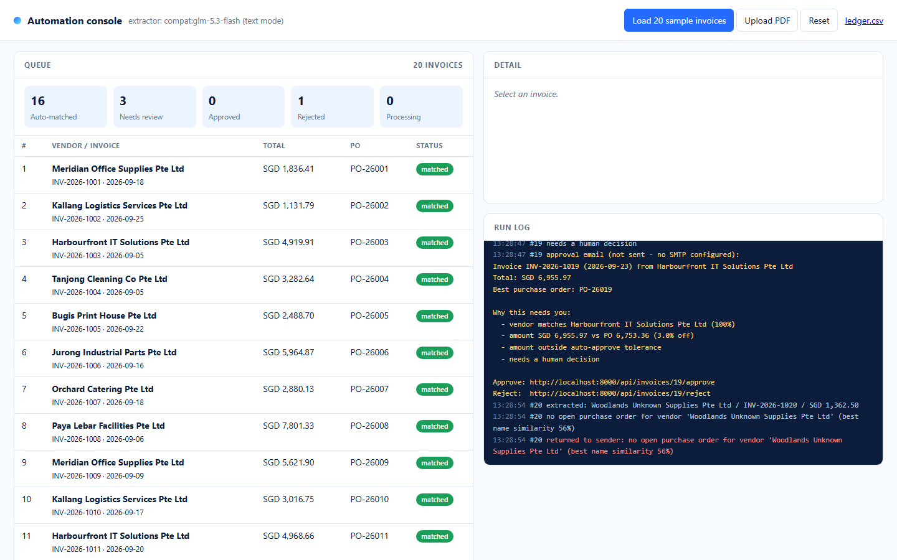

# Workflow Automation Pilot — reference implementation

A small, complete example of the kind of automation [JoyfulAI](https://joyfulai.sg) builds for clients as a fixed-scope pilot: supplier invoices come in as PDFs, an AI agent extracts the fields, matches each invoice to an open purchase order, auto-approves the clean ones, asks a human about the doubtful ones, and posts approved invoices to a ledger. A one-page console shows the queue, every decision and why it was made.

It runs end-to-end on your laptop in a few minutes, with or without an API key.



## Run it

```bash
git clone https://github.com/Joyful-AI-Labs/workflow-pilot && cd workflow-pilot
python -m venv .venv && . .venv/bin/activate        # Windows: .venv\Scripts\activate
pip install -r requirements.txt
cp .env.example .env                                # optional: add ANTHROPIC_API_KEY for real extraction
python -m pilot                                      # http://localhost:8000
```

or `docker compose up` and open http://localhost:8000.

Click **Load 20 sample invoices**. Within a few seconds you should see **16 auto-matched, 3 needing review, 1 rejected**. Open a review item, read the reasons, approve or reject it. `ledger.csv` (link in the header) is the output an accountant would import.

Without credentials the extractor is a regex over the PDF text — enough for the synthetic samples, useless for real invoices. With `ANTHROPIC_API_KEY`, the PDF goes to Claude and comes back as a validated `Invoice` object (structured output). With an Anthropic-compatible endpoint (`ANTHROPIC_BASE_URL` + `ANTHROPIC_AUTH_TOKEN`, e.g. a z.ai GLM plan) the PDF's text is sent and the JSON reply is validated. See `pilot/extract.py`; the rest of the pipeline is the same. Measured: the 20 samples take 44 s on `glm-5.3-flash` via z.ai with the 4 extraction workers (about 8 s per invoice sequentially), same 16/3/1 result as mock mode.

## What happens to an invoice

```
inbox/*.pdf ──► extract ──► match ──► route ──► ledger.csv
   (watcher)    Claude or    vs open     matched  → posted automatically
                regex        POs         review   → approval email with reasons; human clicks approve/reject
                                         rejected → returned with reason
```

Matching rules live in `pilot/match.py` and are deliberately plain: vendor-name similarity, amount tolerance (1% auto, 15% review, beyond that reject), line-item overlap, extraction confidence, and whether the quoted PO number exists. Every rule that fires becomes a line in the log, so a reviewer never sees a bare "needs review".

## Layout

| Path | What |
|---|---|
| `pilot/extract.py` | `ClaudeExtractor` (PDF → structured `Invoice` via `messages.parse`), `CompatExtractor` (text → JSON for Anthropic-compatible endpoints) and `MockExtractor` |
| `pilot/match.py` | Purchase-order matching and the three-way decision |
| `pilot/pipeline.py` | extract → match → route → record; approve/reject |
| `pilot/notify.py` | Approval email (SMTP if configured, otherwise logged) |
| `pilot/ledger.py` | Appends approved invoices to `data/ledger.csv` |
| `pilot/db.py` | SQLite: invoices + event log |
| `pilot/watcher.py` | Polls `data/inbox/`, 4 extraction workers |
| `pilot/app.py` | FastAPI endpoints + the console (`pilot/static/index.html`) |
| `samples/` | 20 synthetic invoices and the PO table; `make_samples.py` regenerates them |
| `tests/` | One end-to-end test (`python -m pytest -q` or `python tests/test_pipeline.py`) |

## Adapting it to a real business

This is the shape of a pilot, not a product. To make it yours, three seams are meant to be replaced:

- **Where invoices come from** — `pilot/watcher.py` polls a folder. Replace with an email inbox (IMAP / Gmail API), a shared drive, or a POST from your scanner.
- **Where purchase orders live** — `match.load_purchase_orders()` reads a CSV. Replace with Xero, QuickBooks, SAP B1, a Google Sheet, or your ERP's API; keep returning `PurchaseOrder` objects.
- **Where decisions go** — `pilot/notify.py` sends an email; `pilot/ledger.py` writes a CSV. Replace with Slack/Teams approvals and a bill-creation call in your accounting system.

Everything else — the extraction prompt, the tolerances in `pilot/config.py`, the decision rules — is the part we tune with you during the pilot's discovery week.

## Notes

- Model: `claude-opus-5`, low effort, structured output via `client.messages.parse` with the `Invoice` Pydantic model. Refusal fallbacks are not enabled; invoice extraction has no realistic refusal path and it keeps the example short. Compatible endpoints get plain `messages.create` with a JSON instruction because they generally do not support `output_config` or PDF document blocks.
- Nothing here is a real company, person or transaction. Sample vendors and amounts are generated by `samples/make_samples.py` with a fixed seed.
- Licence: MIT.

---

JoyfulAI Technology Pte. Ltd., Singapore · [joyfulai.sg](https://joyfulai.sg) · hello@joyfulai.sg
